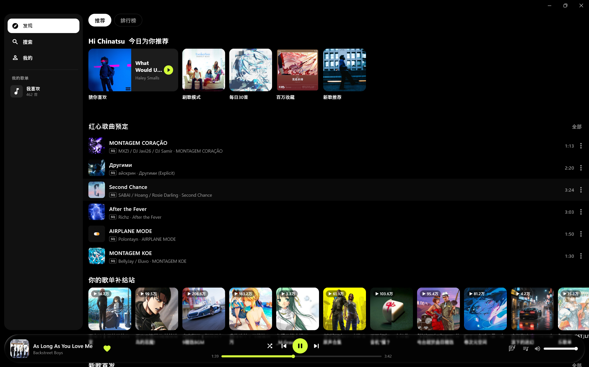
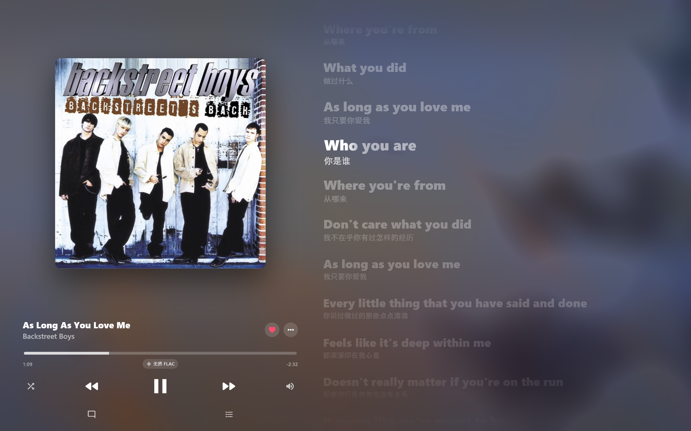
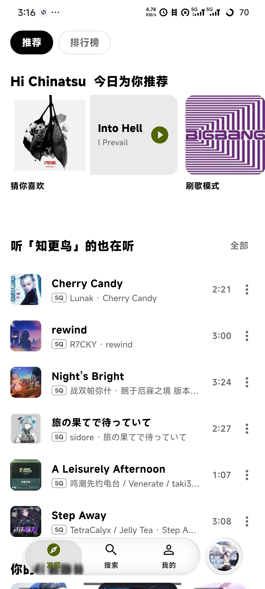
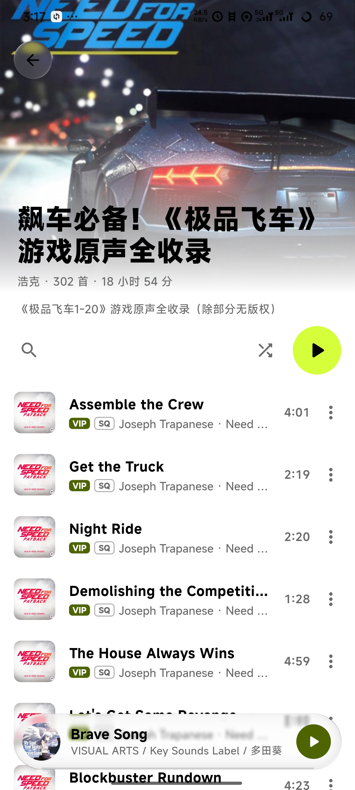
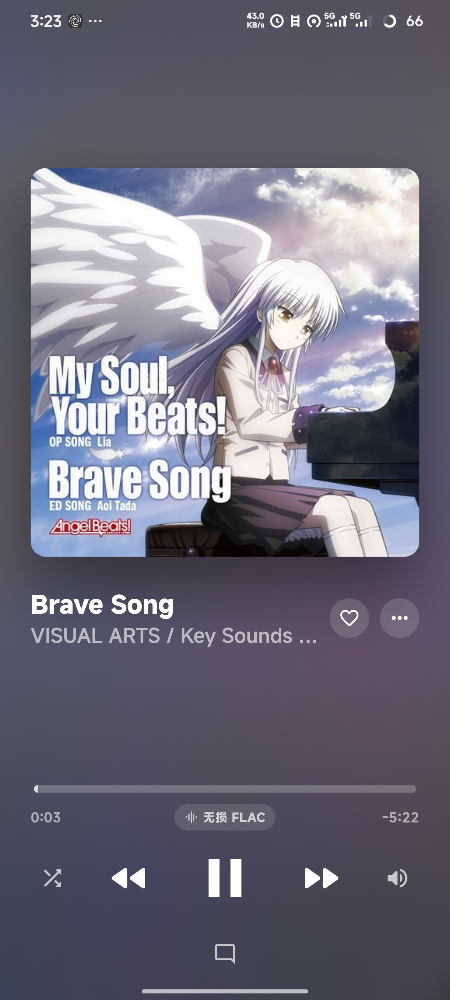
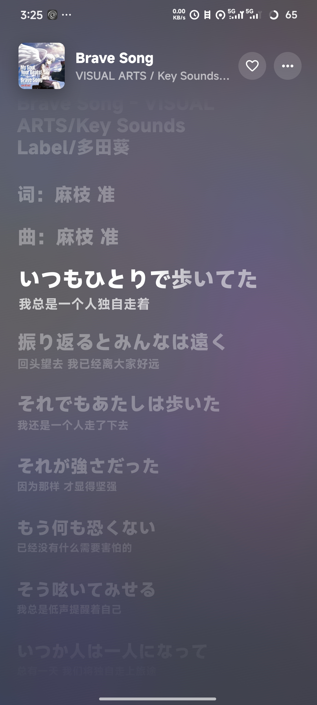

QQ 音乐第三方客户端，支持 Windows 和 Android。

> 本项目仅供个人学习和技术交流，与腾讯 / QQ 音乐没有任何关系。
> 所有音乐内容的版权归各自权利人所有；能播放哪些歌完全取决于你自己账号的权限。
> 本项目只请求官方提供的普通音频格式，**不破解、不处理任何加密格式**。请勿用于商业用途。

<p align="center">
  
</p>
<p align="center">
  
</p>
<p align="center">
  
  
  
  
</p>

## 功能

**发现**
- 推荐页：个性化推荐歌单和歌曲、新歌首发
- 排行榜（推荐和排行榜不登录也能看）

**搜索**
- 热搜榜、猜你想搜，搜索联想

**播放**
- 列表循环、单曲循环、随机播放，播放队列，下一首播放
- 音质菜单只显示这首歌在你账号下**真正能播**的档位
- 歌词和翻译：当前行高亮，点某一行就跳到那里；播放器左滑切到歌词
- 查看MV
- Windows 接入系统媒体控制；Android 支持后台播放，通知栏可以直接点喜欢

**账号**
- 我喜欢、最近播放、我的歌单（创建的和收藏的）
- 新建、重命名、删除歌单，把歌加进歌单或从歌单删掉

**歌手、专辑、用户**
- 歌手页：精选、歌曲、专辑、视频、详情，关注
- 用户页：公开的歌单、收藏、我喜欢，关注
- 歌曲评论

上游接口的请求方式、参数、返回结构以及哪些地方已验证 / 未验证，见 [接口参考](docs/qqmusic-api.md)。

### 运行

需要先安装 [Flutter](https://flutter.dev) 和 [Rust](https://rustup.rs)

```bash
git clone <仓库地址>
cd kanade
flutter pub get
flutter run -d windows
```

## 致谢

- [flutter_rust_bridge](https://github.com/fzyzcjy/flutter_rust_bridge)
- [media_kit](https://github.com/media-kit/media-kit)
- [liquid_glass_widgets](https://pub.dev/packages/liquid_glass_widgets)
- [smtc_windows](https://pub.dev/packages/smtc_windows)
- [audio_service](https://pub.dev/packages/audio_service)
- QQ 音乐 App 授权登录流程参考了 [YAQMC/qm-api-rs](https://github.com/YAQMC/qm-api-rs)
